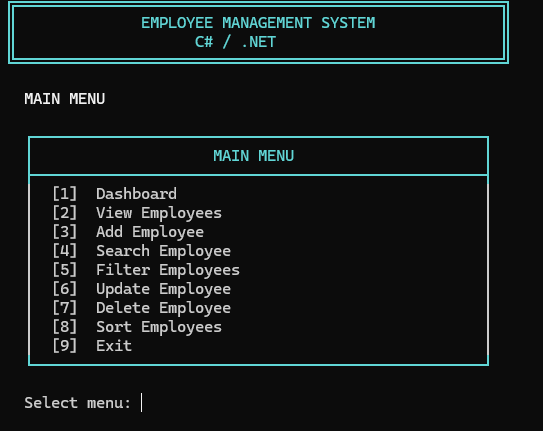
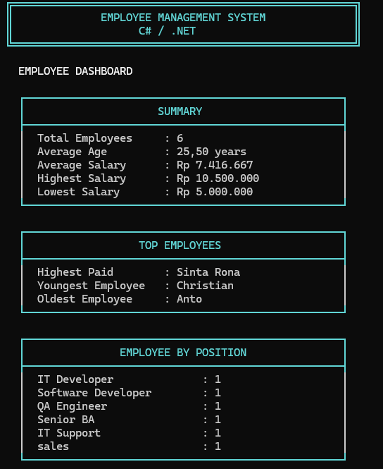
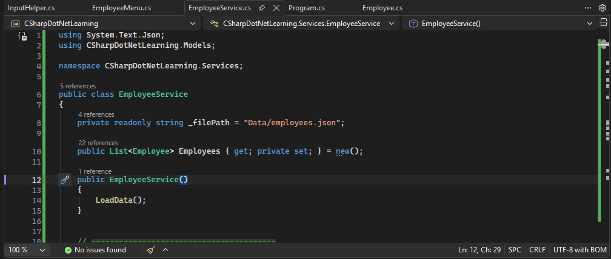
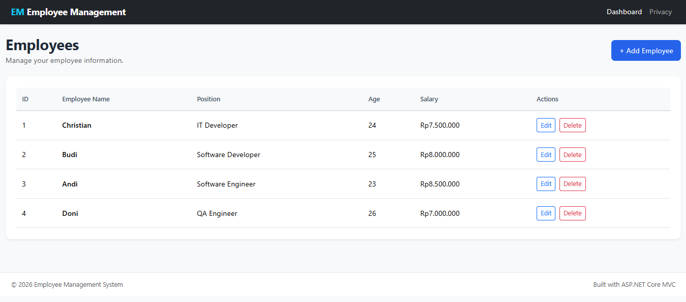

# Employee Management System — C#/.NET

A hands-on Employee Management System built with **C#, .NET 10, and ASP.NET Core MVC**. This project started as a console-based application and has evolved into a web dashboard as part of my continuous learning journey in software development.

The project demonstrates practical experience with Object-Oriented Programming, LINQ, the Repository Pattern, JSON persistence, unit testing, and web application development.

## Features

### Console Application
- Create, view, update, and delete employees
- Search employees by ID or name
- Filter employees by position
- Sort employees by name, age, and salary
- Employee dashboard and statistics
- Employee grouping by position
- Input validation and error handling
- JSON data persistence
- Console-based user interface
- Success, error, and warning messages

### Web Application
- Responsive employee management dashboard
- Dynamic employee count and position statistics
- Employee list with ID, name, position, age, and salary
- Add employees through a web form
- Edit employee information using a Bootstrap modal
- Delete employees with a confirmation modal
- Success and error notifications
- Shared business logic through `EmployeeService`
- JSON-based data persistence

### Testing
- Unit tests using xUnit
- Tests for employee service operations
- Fake repository for isolated service testing

## Screenshots

### Console Application

#### Main Menu



#### Employee Dashboard



#### Development Environment



### Web Application

#### Employee Management Dashboard

The dashboard displays employee statistics and provides an overview of employee records.

<!-- Add a dashboard screenshot when available:

-->

#### Employee List and CRUD Operations

The employee management page displays employee records with actions to add, edit, and delete employees.



The web interface includes:
- Employee ID, name, position, age, and salary
- An Add Employee form
- An Edit Employee modal
- A Delete Employee confirmation modal

## Tech Stack

| Technology | Purpose |
|---|---|
| C# | Application programming language |
| .NET 10 | Application platform |
| ASP.NET Core MVC | Web application architecture |
| Razor Views | Server-rendered web pages |
| HTML, CSS, JavaScript | Web interface and interactions |
| Bootstrap | Responsive UI and modals |
| LINQ | Searching, filtering, sorting, and grouping |
| System.Text.Json | JSON serialization and deserialization |
| Repository Pattern | Separation of data access and business logic |
| Dependency Injection | Managing application services |
| xUnit | Unit testing |
| Git & GitHub | Version control and source code hosting |

## Project Structure

```text
CSharpDotNetLearning/
├── CSharpDotNetLearning/
│   ├── Data/
│   │   └── employees.json
│   ├── Models/
│   │   └── Employee.cs
│   ├── Repositories/
│   │   ├── IEmployeeRepository.cs
│   │   └── EmployeeRepository.cs
│   ├── Services/
│   │   └── EmployeeService.cs
│   ├── UI/
│   │   ├── EmployeeMenu.cs
│   │   └── InputHelper.cs
│   ├── CSharpDotNetLearning.csproj
│   └── Program.cs
│
├── CSharpDotNetLearning.Tests/
│   ├── EmployeeServiceTests.cs
│   ├── FakeEmployeeRepository.cs
│   └── CSharpDotNetLearning.Tests.csproj
│
├── EmployeeManagement.Web/
│   ├── Controllers/
│   │   ├── HomeController.cs
│   │   └── EmployeesController.cs
│   ├── Models/
│   ├── Views/
│   │   ├── Home/
│   │   ├── Employees/
│   │   │   ├── Index.cshtml
│   │   │   └── Create.cshtml
│   │   └── Shared/
│   ├── wwwroot/
│   │   ├── css/
│   │   └── js/
│   ├── EmployeeManagement.Web.csproj
│   └── Program.cs
│
├── Screenshots/
│   ├── Code.png
│   ├── main-menu.png
│   ├── Dashboard.png
│   └── web-employees.png
│
├── .gitignore
├── CSharpDotNetLearning.slnx
└── README.md
```

## Architecture

### Models

The `Employee` model represents employee information, including ID, name, position, age, and salary.

### Services

`EmployeeService` contains employee business logic, including CRUD operations, searching, filtering, and grouping.

### Repositories

`IEmployeeRepository` defines the repository contract, while `EmployeeRepository` handles loading and saving employee records using JSON.

### Console UI

The console application provides menus, input handling, employee information displays, and dashboard statistics.

### Web Application

The ASP.NET Core MVC application provides a browser-based interface using controllers and Razor views. Dependency injection connects the web application to the shared employee service and repository.

### Unit Testing

The xUnit test project verifies employee service behavior. A fake repository allows service operations to be tested without relying on the actual JSON data file.

## Getting Started

### Prerequisites

- [.NET SDK](https://dotnet.microsoft.com/download) compatible with .NET 10
- Git
- Visual Studio or Visual Studio Code

### 1. Clone the repository

```bash
git clone https://github.com/Chrisjohanes/csharp-employee-management-system.git
cd csharp-employee-management-system
```

### 2. Build the solution

```bash
dotnet build CSharpDotNetLearning.slnx
```

### 3. Run the console application

```bash
dotnet run --project CSharpDotNetLearning/CSharpDotNetLearning.csproj
```

### 4. Run the web application

```bash
dotnet run --project EmployeeManagement.Web/EmployeeManagement.Web.csproj
```

Open the local URL displayed in the terminal to access the web dashboard.

### 5. Run unit tests

```bash
dotnet test CSharpDotNetLearning.slnx
```

## Data Persistence

Employee records are stored in JSON format:

```text
CSharpDotNetLearning/Data/employees.json
```

The application uses `System.Text.Json` to serialize and deserialize employee data.

Both the console and web applications are configured to use the same employee data file. Changes made through supported employee operations are saved to JSON and remain available after the application is restarted.

Because JSON file storage does not provide database-style transactions or concurrency control, avoid modifying the same file simultaneously from multiple application instances.

## Employee Dashboard

The console application provides employee statistics such as:

- Total employees
- Average age
- Average salary
- Highest and lowest salary
- Highest-paid employee
- Youngest and oldest employee
- Employee count by position

The web dashboard currently displays:
- Total employees
- Number of unique employee positions
- Employee records in a table

Employee status and joining-date statistics are planned for future improvements.

## Search, Filter, and Sorting

The console application supports:

- Searching by employee ID
- Searching by employee name
- Filtering by position
- Sorting by name, age, and salary

The search and filter functionality uses LINQ and case-insensitive text matching.

## Input Validation

The applications perform input validation to help ensure that employee information is valid.

Validation includes required text fields, valid employee age, and non-negative salary values.

The web application also uses server-side checks for employee creation and updates.

## Learning Goals

This project helps me practice:

- C# syntax and fundamentals
- Classes, objects, and Object-Oriented Programming
- Collections and LINQ
- Methods, loops, and conditional statements
- Exception handling
- File I/O and JSON serialization
- Input validation
- Separation of concerns
- Repository Pattern
- Dependency Injection
- ASP.NET Core MVC and Razor Views
- HTML, CSS, JavaScript, and Bootstrap
- Unit testing with xUnit
- Git branching, commits, and GitHub workflows

## Current Status

**Console application and web CRUD implemented.**

The project has evolved from a console-based employee management application into a solution that also includes an ASP.NET Core MVC web dashboard.

The web application currently supports viewing, creating, editing, and deleting employee records with JSON persistence.

## Future Improvements

- Search, filtering, and pagination in the web interface
- Employee status and joining date
- More comprehensive automated tests
- SQL Server database integration
- Entity Framework Core
- ASP.NET Core Web API
- Authentication and authorization
- Improved validation and error handling
- Deployment to a hosting platform

## Learning Journey

This project is part of my hands-on journey toward becoming a .NET developer.

I am building it incrementally, applying new concepts as I learn them, and improving the architecture as the application grows.

My goal is to evolve this project into a more complete, maintainable, and production-oriented .NET application.

## Repository

GitHub: [Chrisjohanes/csharp-employee-management-system](https://github.com/Chrisjohanes/csharp-employee-management-system)
